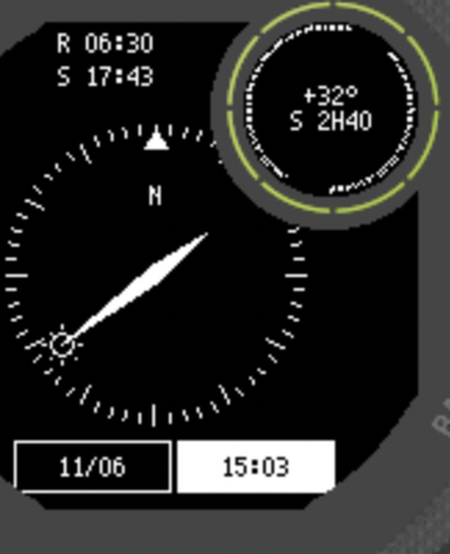

# SunScout · 踩点太阳罗盘

给 Garmin Instinct 2X 写的一个小应用：**抬腕看太阳在哪个方向，拨时间轴预览任意时刻的太阳位置。**

拍摄踩点用的——站在机位上转一圈，就知道几点钟光会从哪个方向来。

> 个人自制应用，非 Garmin 官方。仅支持 **Instinct 2X / 2X Solar / 2X Solar Tactical**。

## 它解决什么问题

踩点的时候我们常要判断：这个机位早上 6 点半会不会被对面的楼挡光？下午 4 点太阳会不会正好怼进镜头？

普通罗盘只能告诉你「北在哪」，这个应用直接告诉你「**太阳在哪**」，而且可以把时间往前拨到明天早上，提前看光的方向。

## 功能

- 罗盘式太阳方位显示，指针随手腕转动实时更新（100ms 缓动，转动跟手不卡顿）
- 时间轴可调：15 分钟步进，可跨天、跨月预览任意日期任意时刻
- 日出日落时刻直接显示在左上/右上，日落前后 ±20 分钟整行反白提醒
- 小圈显示：太阳高度角 + 距日出/日落倒计时（如 `+45°` / `S 4H04`）
- 太阳在地平线下时指针变空心、光芒消失，一眼区分白天黑夜
- 全程离线计算，山里海边没信号照样用

## 安装

**必须用电脑（Windows / Mac），不能用手机 Garmin Connect 装。**

1. 用手表数据线连电脑，会出现一个 `GARMIN` 盘
2. 把 `SunScout.prg` 复制到 `GARMIN/GARMIN/APPS/`
3. 弹出磁盘、拔线
4. 手表按**右上角 GPS 键**打开应用列表 → 找到 SunScout

详细步骤（含常见问题）见 [INSTALL.md](INSTALL.md)。

## 操作

| 键 | 功能 |
|---|---|
| UP / DOWN | 调整反白字段：时间 ±15 分钟 / 日期 ±1 天（可跨月） |
| GPS 键（右上） | 切换「调时间 / 调日期」 |
| 长按 UP | 菜单：跳到日出 / 跳到日落 / 回到现在 / 步长切换 / 重新定位 |
| BACK（右下） | 退出 |

## 太阳位置算法

采用 NOAA（美国国家海洋和大气管理局）公开的太阳位置公式，与 NOAA Solar Calculator、timeanddate 同源（本质是 Meeus《Astronomical Algorithms》的低精度太阳历表）：

1. 由 J2000 纪元起算天数 n → 太阳平黄经 L、平近点角 g
2. 黄经 λ = L + 1.915·sin g + 0.020·sin 2g，黄赤交角 ε ≈ 23.44°
3. 求赤纬 δ 与赤经 RA
4. 恒星时 GMST → 地方时角 H
5. 高度角 = asin(sinφ·sinδ + cosφ·cosδ·cosH)，方位角以真北为 0° 顺时针
6. 日出日落按太阳中心穿过 -0.833°（含大气折射与视半径）求解

典型误差 < 0.5°（太阳视直径本身就有 0.5°，对踩点足够）。方位角为**真北**基准，若手表罗盘设置为磁北会有约 2° 偏差，建议在系统设置里改成真北。

## 已知限制

- 只编译了 `instinct2x` 一个型号，其他型号装了不会出现在应用列表
- 重装应用会清空定位缓存，需要在户外或窗边重新定位一次
- 首次使用若无定位记录，会先用深圳坐标兜底显示，拿到真实定位后自动覆盖

## 更新日志

- **v1.0** — 首个公开版本：刻度环 / 指针+太阳图标 / 点阵小字 / 缓动平滑 / 时间轴

## 声明

个人自制的自签名应用，仅供个人使用。不保证任何特定用途的准确性，户外请以自己的判断为准。禁止商用二次分发。
